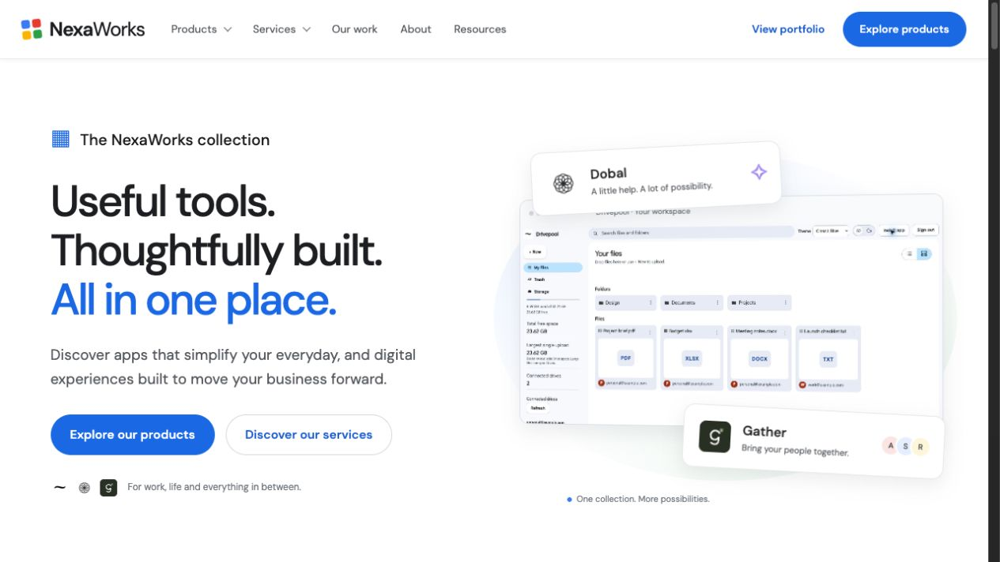
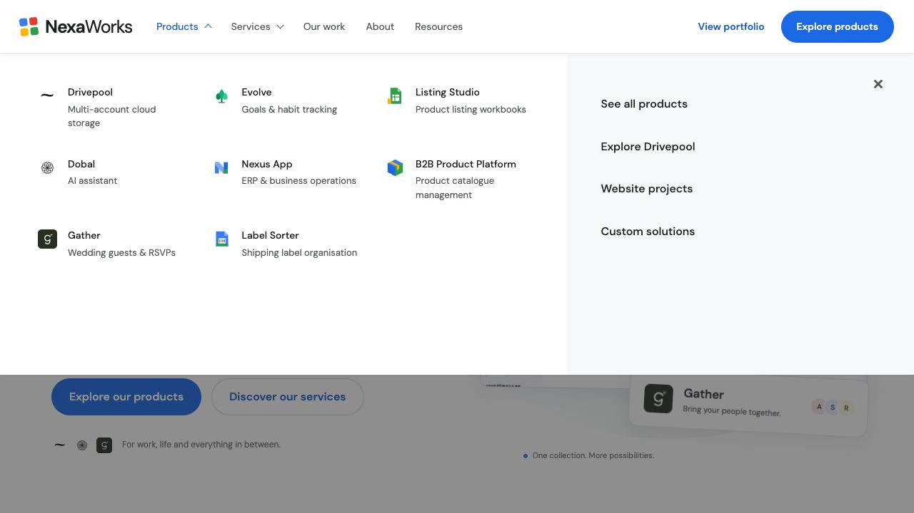
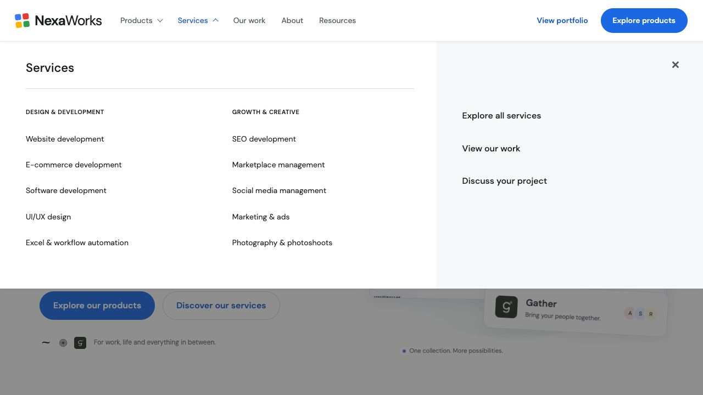
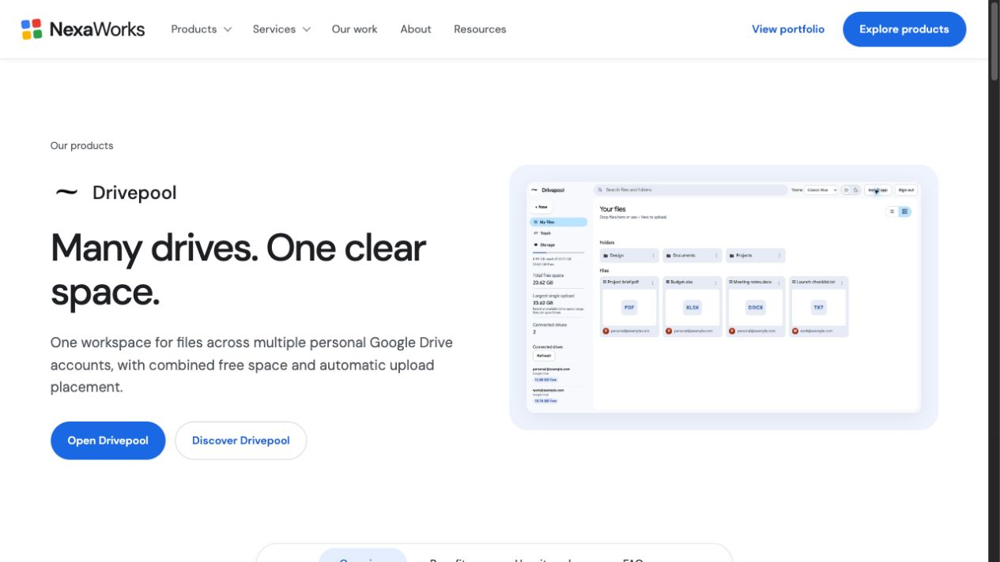
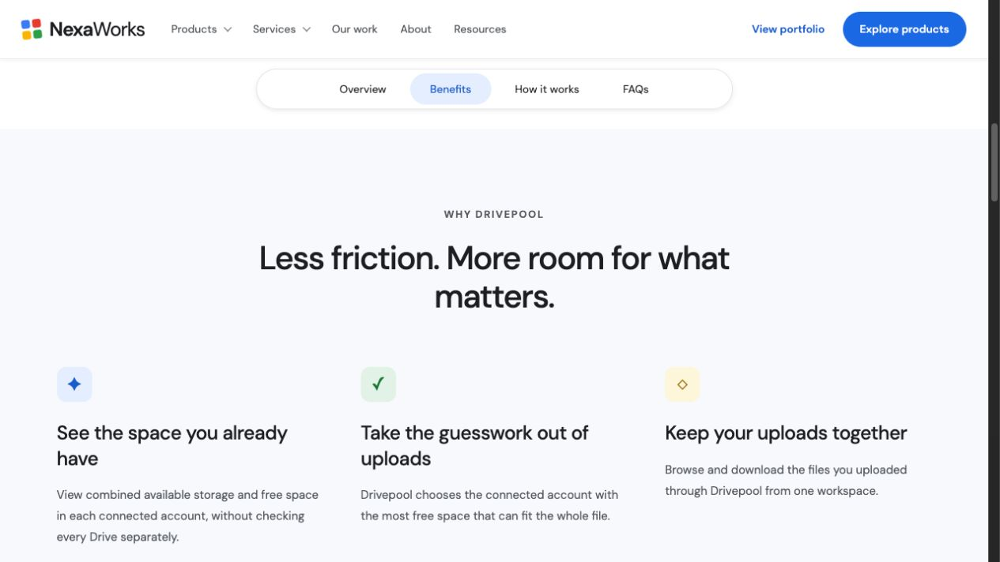
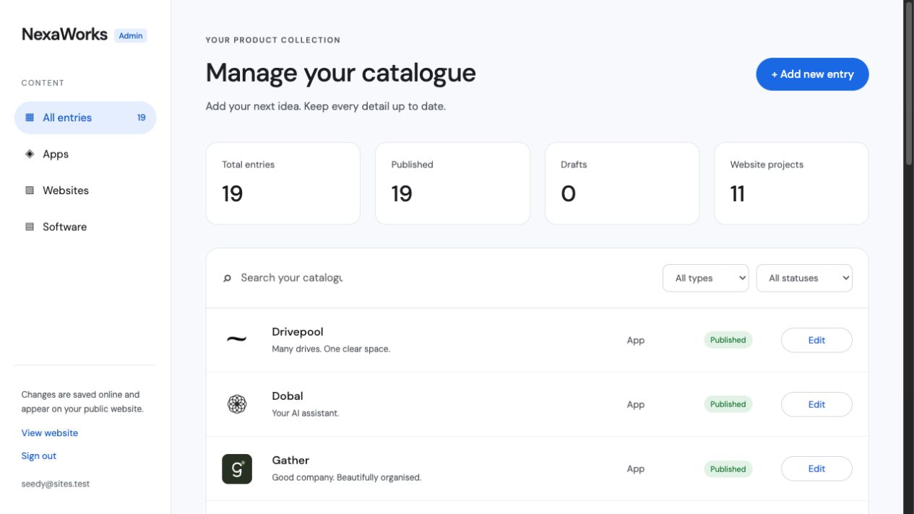
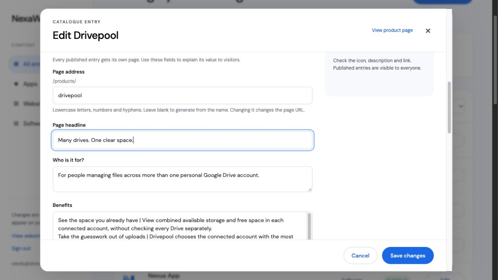
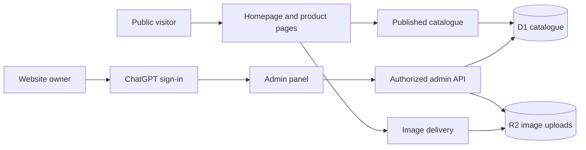

# NexaWorks · cdots

A public home for apps, websites and software by **Lokesh Kumawat**, with individual product pages and an owner-only content management panel.

**[Live website](https://nexaworks-product-studio.ravi550987.chatgpt.site/)** · **[Admin panel](https://nexaworks-product-studio.ravi550987.chatgpt.site/admin)** · **[Example product page](https://nexaworks-product-studio.ravi550987.chatgpt.site/products/drivepool)**

The current website display name is **NexaWorks**. `cdots` is the GitHub repository name; the display name can be changed later in the source.



## What this project includes

- A responsive product hub with the clean white/blue visual direction requested for the site.
- Full-width **Products** and **Services** dropdowns, product icons and short descriptions.
- Product search, category filters and an app-icon collection linking to product introductions.
- An individual, server-rendered page for every published app, software entry and website project.
- Product overviews, intended audiences, benefits, use cases, getting-started steps, FAQs, galleries and external launch links.
- A rounded section-navigation bar that becomes sticky beneath the main header, on the homepage and individual product pages.
- An owner-only admin dashboard to add and edit entries, upload images, manage page copy and control publication.
- Persistent catalogue storage in **Cloudflare D1**, and uploaded images in **Cloudflare R2**.
- Draft/published visibility, display ordering, conflict detection for concurrent edits and a JSON backup export.

This repository contains the website and its catalogue. The individual apps linked from the catalogue run as separate projects on their own websites.

## Screenshots

The public-site screenshots below were captured from the deployed website. Admin screenshots use the **local demo account**; production administrator access is restricted separately.

### Product navigation

Clicking an app opens its introduction page. The page's **Open app** action launches the external product.



### Services navigation

Services are grouped into design/development and growth/creative work, with links to the relevant service section.



### Individual product page

Each page explains the purpose of the product, its practical benefits and the next steps for a visitor.



### Sticky section bar

The section bar remains below the global navigation as the visitor scrolls. The current section is highlighted.



### Admin dashboard

Search and filter the collection by type or visibility, then add a new entry or edit an existing one.



### Product-page editor

Product copy, audiences, benefits, use cases, steps, FAQs and the page address are editable from the same panel.



## Included apps and software

The initial collection contains **8 app/software entries** and **11 website projects**. Administrators can extend it without changing application code.

| Product | What it is for | Introduction page |
| --- | --- | --- |
| Drivepool | One workspace for uploads across multiple personal Google Drive accounts, combined free space and automatic upload placement | [/products/drivepool](https://nexaworks-product-studio.ravi550987.chatgpt.site/products/drivepool) |
| Dobal | An AI chat workspace with Notes and a PDF attachment option | [/products/dobal](https://nexaworks-product-studio.ravi550987.chatgpt.site/products/dobal) |
| Gather | Wedding invitations, family RSVPs, attendance and catering counts | [/products/gather](https://nexaworks-product-studio.ravi550987.chatgpt.site/products/gather) |
| Evolve | Personal goals, daily habits, vision boards, gratitude journaling and progress dashboards | [/products/evolve](https://nexaworks-product-studio.ravi550987.chatgpt.site/products/evolve) |
| Nexus App | A business-specific ERP and operations platform for manufacturing/export teams | [/products/nexus](https://nexaworks-product-studio.ravi550987.chatgpt.site/products/nexus) |
| Label Sorter | Browser-local processing of multi-page shipping-label PDFs, grouped by courier and SKU | [/products/label-sorter](https://nexaworks-product-studio.ravi550987.chatgpt.site/products/label-sorter) |
| Listing Studio | A private Excel listing-workbook generator using a template and product images | [/products/listing-studio](https://nexaworks-product-studio.ravi550987.chatgpt.site/products/listing-studio) |
| B2B Product Platform | A project **in development** for product catalogues, document preparation and buyer communication | [/products/b2b-product-platform](https://nexaworks-product-studio.ravi550987.chatgpt.site/products/b2b-product-platform) |

**Website projects:** Bois & Chiffons, Itauti, Bellru, OptimizeAI, Debori, OMMAN, Blogy Vlogy, Life Mentore, PG Management, Dhora Cinema and Beauty Store.

Access and availability are controlled by each external app. Where no public product link is listed, the site shows an enquiry action. The B2B page describes planned capabilities rather than claiming that they are already released.

## Services shown on the website

- Website development and UI/UX design.
- E-commerce development, including Shopify and WordPress storefronts.
- Custom business software and operational workflows.
- Excel, catalogue, marketplace and Photoshop automation.
- SEO, marketplace management, social media, marketing and advertising.
- Photography and photoshoots.

The service copy is currently maintained in source; the admin panel manages catalogue entries and their individual pages.

## How to use the admin panel

1. Open `/admin` on the deployed website.
2. Sign in with the ChatGPT account authorized as the website owner. A signed-in owner may already be recognized automatically.
3. Select **Add new entry**, or **Edit** next to an existing product.
4. Choose its type: **App**, **Website** or **Software**.
5. Enter its name, category, tagline, navigation description, short description and full description.
6. Add its external app/website URL and, optionally, a GitHub URL. A blank app URL produces an access-enquiry action.
7. Upload an icon, cover image and additional images, or enter image URLs.
8. Complete the **Individual product page** fields.
9. Set the display order and publication status, then select **Save changes**.

### Individual page fields

| Field | Purpose |
| --- | --- |
| Page address | The unique slug under `/products/`, such as `drivepool` |
| Page headline | The main benefit or introduction at the top of the page |
| Who is it for? | The intended user or team |
| Benefits | Reasons the product is useful |
| Practical use cases | Situations in which a user would use it |
| How to get started | Ordered instructions for beginning |
| Product FAQs | Questions and answers specific to the product |

For benefits, use cases, steps and FAQs, enter **one item per line** in this format:

```text
Save time | Explain the task this product makes easier.
Stay organised | Explain what the user can bring into one place.
```

Use lowercase letters, numbers and hyphens in page addresses. Each address must be unique. Changing it changes the URL; automatic redirects from the old URL are not implemented.

If custom page fields are left blank for a new product, the server generates a basic introduction from its catalogue details. Empty optional sections are omitted. Initial app-specific copy is supplied in `content/product-pages.json`.

### Drafts, visibility and ordering

- **Published on the website = on:** the entry and its page are public after saving.
- **Published on the website = off:** the entry stays in admin as a draft, and its public page returns **404**.
- To hide an entry, turn publication off and save. There is no permanent-delete control in the dashboard.
- Lower **Display order** values appear first.
- Apps/software appear in the product collection and menu. Website entries appear in the website-project section.
- A save from an outdated editor is rejected with a conflict message. Reload the latest catalogue, review your open entry and save again.

### Images and backups

- Upload types: **PNG, JPG, WebP, GIF and plain SVG**.
- Maximum upload size: **5 MB per image**.
- Up to **12 additional gallery images** per entry.
- Icons, cover images and gallery images are stored online in R2. Removing an image from an entry removes its reference; it does not currently purge the stored object.
- Use **Export backup** in the dashboard to download catalogue JSON. The export contains image references, not an archive of the image bytes. There is no backup-import button yet.

## Technology and architecture

| Layer | Implementation |
| --- | --- |
| Server framework | Vinext, using Next-compatible route handlers and Vite |
| Runtime | Cloudflare Workers |
| Public presentation | Server-rendered HTML, CSS and browser JavaScript |
| Catalogue storage | Cloudflare D1 / SQLite |
| Image storage | Cloudflare R2 |
| Schema tooling | Drizzle schema declarations and SQL migrations |
| Hosted identity | ChatGPT sign-in supplied by Sites dispatch |
| Current hosting | Codex Sites |



### Storage behaviour

`catalog_state` stores the catalogue JSON, revision and update time. `admin_principals` stores the authorized owner's stable Site user ID. Images are separate objects in R2.

Before the first catalogue save, the server falls back to `content/seed-catalog.json`. After a save, D1 is the source of truth. Editing the seed file does **not** replace already-saved production content. Missing page content in older records is enriched at read time, while saved owner edits take precedence.

Local development data and production data are separate. Neither local D1 files nor R2 uploads are included in a Git push.

## Local development

### Requirements

- Node.js **22.13.0 or newer**, compatible with the dependencies in `package-lock.json`.
- npm and Git.
- A platform supported by the bundled Wrangler/workerd dependencies.

### 1. Clone and install

```bash
git clone https://github.com/Luckykumawat/cdots.git
cd cdots
npm run install:ci
```

The installer uses the committed lockfile and includes development and optional dependencies. If your default npm cache is not writable, set `npm_config_cache` to a writable directory for the install.

### 2. Build the local Worker configuration

```bash
npm run build
```

This produces `dist/server/wrangler.json`, which declares the local `DB` and `BUCKET` bindings. The execution-profile helper defaults to the portable profile in a clean clone.

### 3. Apply the existing schema to local D1

Run this once for a fresh local database:

```bash
node --import ./scripts/sites-env.mjs ./node_modules/wrangler/bin/wrangler.js d1 execute DB --local --config dist/server/wrangler.json --persist-to .wrangler/state --file drizzle/0000_supreme_johnny_blaze.sql
```

Do not replay an already-applied migration. This command affects only the local preview database.

### 4. Start the development server

```bash
npm run dev -- --port 8765
```

Open the exact local URL printed by the server, normally [http://127.0.0.1:8765](http://127.0.0.1:8765). Use the same hostname consistently when signing in and testing admin actions.

For local admin access, visit:

```text
http://127.0.0.1:8765/signin-with-chatgpt?return_to=/admin
```

The development integration supplies `local_seedy` / `seedy@sites.test`. This mock identity is accepted **only in development** and is not accepted by production authorization.

### Useful commands

| Command | Purpose |
| --- | --- |
| `npm run install:ci` | Install locked dependencies |
| `npm run dev -- --port 8765` | Development preview with reload |
| `npm run build` | Build the deployable Worker and client assets |
| `npm start -- --port 8765` | Run the built Worker locally; no mock sign-in |
| `npm run db:generate` | Generate a new migration after a schema change |
| `node --check public/app.js` | Check public browser JavaScript syntax |
| `node --check public/admin.js` | Check admin browser JavaScript syntax |
| `node --check public/product-page.js` | Check product-page JavaScript syntax |
| `node --check public/section-navigation.js` | Check section-navigation JavaScript syntax |

## Deployment

The live project currently uses **Codex Sites**, with its identity and logical storage bindings declared in `.openai/hosting.json`:

```json
{
  "project_id": "appgprj_6b09231b6abc819183746c1dc5e05077",
  "d1": "DB",
  "r2": "BUCKET"
}
```

For the existing Site, preserve that project ID, build the exact source state, synchronize the Site's bound source repository, save a matching version and deploy it through Sites. Sites provisions the hosted D1/R2 resources and applies pending schema migrations during publication.

**Pushing to this GitHub repository does not automatically redeploy the current Site.** No GitHub Actions deployment workflow has been configured here. The GitHub repository is the source copy; publication is a separate operation.

For a separate Site, create a new Site identity and new storage resources instead of reusing the production project's identity. A new deployment must also configure its intended administrator.

This is a server-backed website, so it cannot run in full on GitHub Pages or as a plain static HTML upload. A non-Sites deployment needs its own Worker/storage configuration and a trusted authentication integration. Do not expose an admin API that trusts identity headers supplied directly by an arbitrary client.

## Authorization and validation

- Public visitors can browse without signing in.
- Admin endpoints require platform-verified identity and server-side owner authorization.
- Initial owner bootstrap is restricted to `OWNER_EMAIL` in `lib/catalog.ts`. After bootstrap, authorization uses the stable Site user ID recorded in D1. Review this configuration for any separate deployment.
- Changing the bootstrap email alone does not remove an administrator already recorded in a deployed database.
- Writes require a same-origin request. Catalogue saves use revision checks to avoid silently overwriting another editor.
- Page slugs, catalogue fields, links and uploaded image types/sizes are validated server-side.
- Product-page text is HTML-escaped. SVG uploads reject unsupported embedded content, and uploaded media is served with restrictive headers.
- No passwords, GitHub credentials, production database files or local authentication cookies belong in this repository.

## Routes

| Route | Purpose |
| --- | --- |
| `/` | Public product hub |
| `/products/[slug]` | Individual published product/project page |
| `/admin` | Admin UI; the API enforces owner access |
| `GET /api/catalog` | Published entries only |
| `GET /api/admin/session` | Check administrator identity |
| `GET /api/admin/catalog` | Full catalogue for the authorized owner |
| `PUT /api/admin/catalog` | Validate and save the catalogue |
| `POST /api/admin/upload` | Upload an image for the authorized owner |
| `/media/[key]` | Serve a stored image |

`/signin-with-chatgpt`, `/signout-with-chatgpt` and `/callback` are owned by the hosting authentication integration; the application does not implement its own OAuth provider.

## Repository map

```text
app/
  route.ts                       Public homepage response
  admin/route.ts                 Admin HTML response
  products/[slug]/route.ts        Product-page route
  api/catalog/                   Public catalogue API
  api/admin/                     Owner-only session, catalogue and upload APIs
  media/[key]/                   Uploaded-image delivery
content/
  index.html                     Homepage and shared site chrome
  admin.html                     Admin editor markup
  seed-catalog.json              Initial catalogue fallback
  product-pages.json             Initial app-specific page copy
lib/
  catalog.ts                     Storage, authorization and validation
  product-content.ts             Slugs and fallback page content
  product-page.ts                Product-page HTML renderer
public/
  app.js, style.css              Homepage behaviour and styling
  admin.js, admin.css            Admin behaviour and styling
  product-page.js, .css          Individual page behaviour and styling
  section-navigation.js          Sticky-bar active-section tracking
  assets/                        Bundled icons, screenshots and illustrations
worker/index.ts                  Cloudflare Worker entrypoint
vite.config.ts                   Vinext, Sites and local binding integrations
db/schema.ts                     Database schema declarations
drizzle/                         Versioned schema migrations
docs/screenshots/                README screenshots
scripts/                         Installation, build and runtime helpers
.openai/hosting.json              Existing Site identity and storage bindings
```

Some UI dependencies and helper directories are inherited from the Sites starter; the catalogue itself is rendered with HTML, CSS and browser JavaScript.

## Customization and content maintenance

- **Site name and shared navigation:** `content/index.html` and metadata in `app/layout.tsx`; product pages reuse the shared chrome.
- **Homepage structure:** `content/index.html`.
- **Services and homepage interactions:** `public/app.js`.
- **Product introduction layout:** `lib/product-page.ts` and `public/product-page.css`.
- **Initial app copy:** `content/product-pages.json`. Saved admin page content overrides this fallback.
- **Owner bootstrap configuration:** `lib/catalog.ts`.
- **Live entries and product-page content:** use `/admin`.

The homepage's curated spotlight/about/service sections are source-maintained. The admin editor controls catalogue cards, app menus, website-project entries and individual product pages; it is not a general page-layout builder.

### Brand and image notes

- Drivepool uses the `icon-192.png` asset referenced by its own website header.
- Dobal's transparent, black-line variant is used only in this catalogue; Dobal's original site was not changed.
- Evolve's tree vector was taken from the public logo component at the user-supplied Evolve URL.
- Gather uses its own logo and a clearly labelled illustrative invitation image, replacing the older GOLANJI graphic.
- Listing Studio and B2B use the replacement vector icons selected for this catalogue.
- The Google Workspace site was a visual-layout reference. This project is an independent product hub and is not affiliated with Google.

## Validation performed

During implementation, the following were checked:

- All 19 initial product/project pages returned successful responses.
- Unknown and unpublished product pages returned 404.
- Admin add/edit/save, image uploads and public publication were exercised.
- Draft entries stayed out of the public catalogue.
- Concurrent stale saves, invalid/duplicate slugs, unsafe links and unauthorized writes were rejected.
- Custom product-page copy persisted and HTML-sensitive text was escaped.
- Desktop/mobile layouts, sticky section bars, category filters, product links and FAQ controls were checked in a browser.
- Production catalogue saves, image storage and product-page navigation were verified on the live Site.
- Browser JavaScript syntax checks and the production build passed for the application version copied here.

These describe the checks performed while building the site; a permanent automated test suite has not been added to this repository.

## Current scope and limitations

- External apps have independent availability, pricing and access rules.
- The B2B Product Platform is described as in development.
- Admin editing is restricted to the configured owner; a multi-admin invitation UI is not implemented.
- Backup export does not include R2 image bytes, and backup import is not implemented.
- Slug redirects, automatic image purging and automatic GitHub-to-Sites deployment are not configured.
- Source changes alone do not replace saved D1 catalogue content.

## Credits and contact

Built around the work of **Lokesh Kumawat**, founder of **OptimizeAI**.

- [Portfolio](https://luckykumawat.github.io/Portfolio/index.html)
- [OptimizeAI](https://optimizeai.in/)
- [GitHub](https://github.com/Luckykumawat)
- [Email](mailto:okuma.jaipur@gmail.com)

No open-source license has been chosen for this repository. Brand marks and third-party assets retain their respective ownership.
